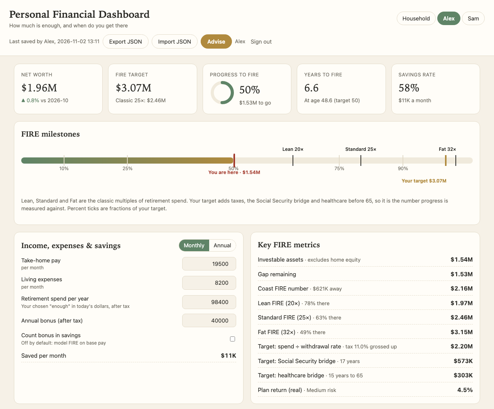
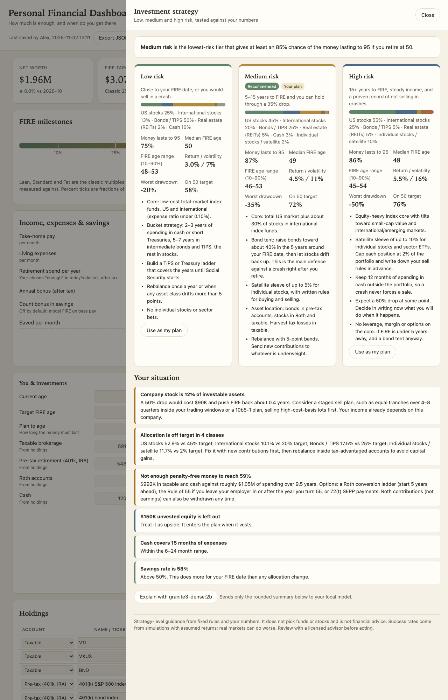
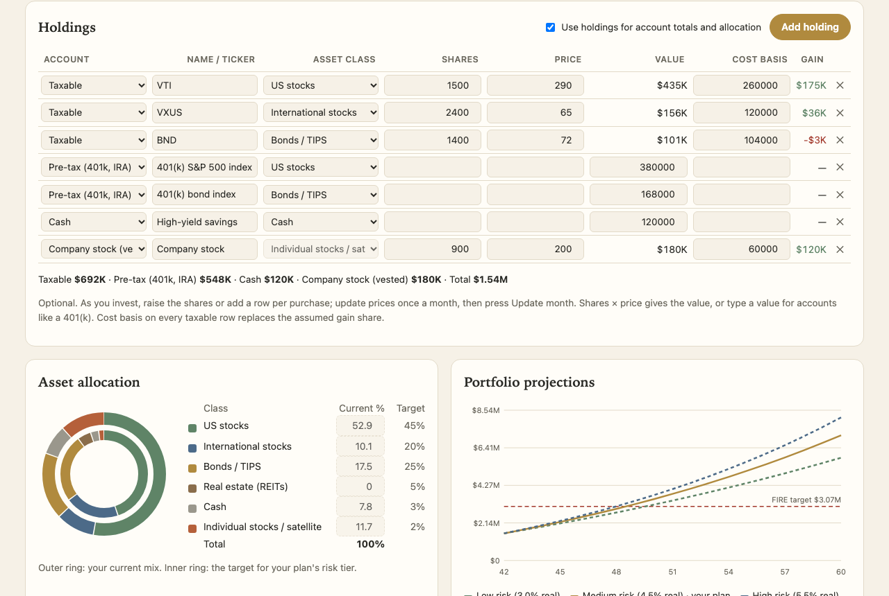
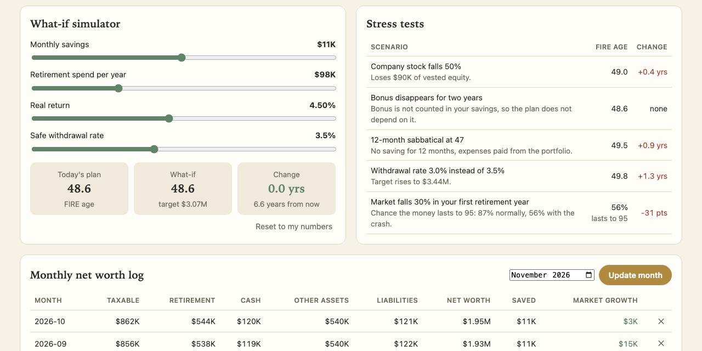
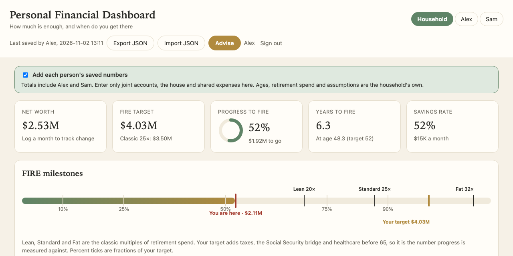
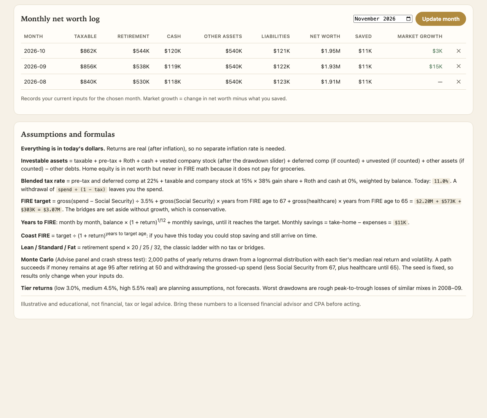
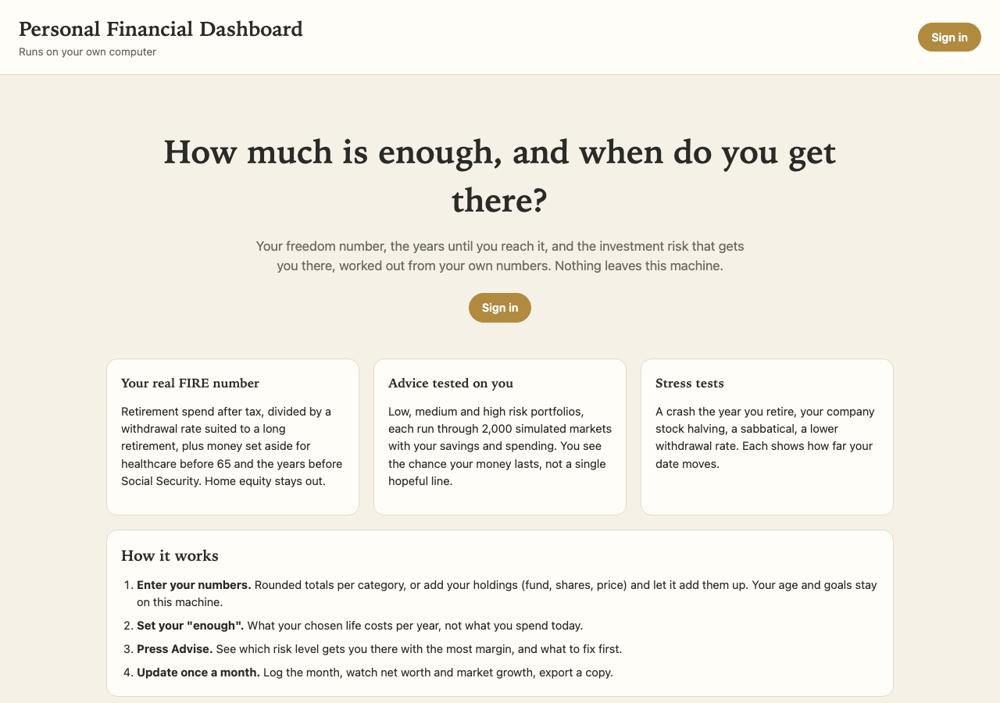
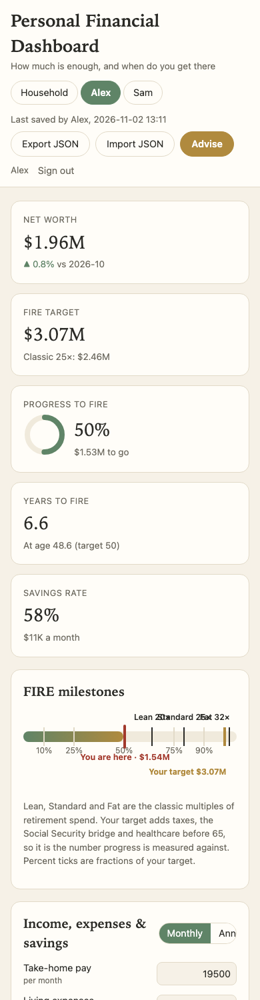
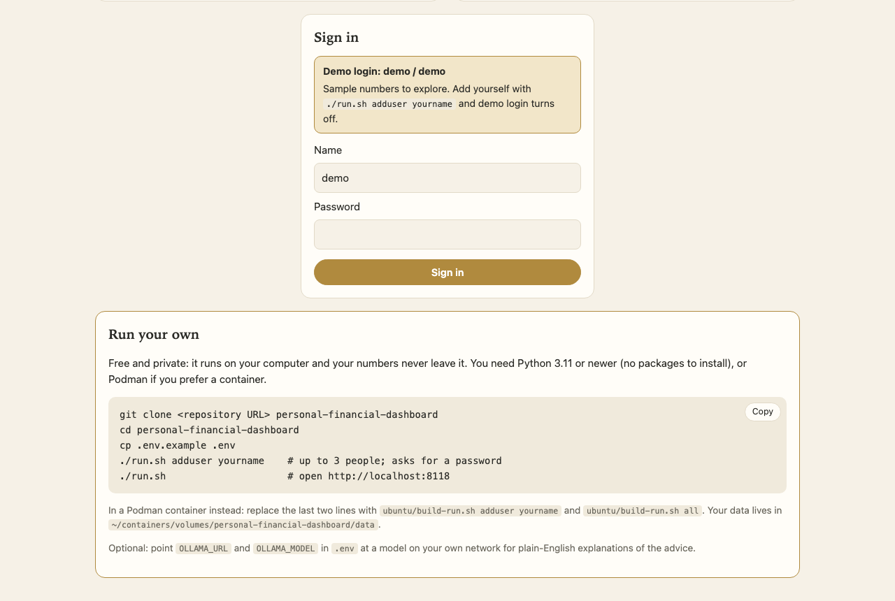

# Personal Financial Dashboard

**How much is enough, and when do you get there?**

A private FIRE (financial independence, retire early) dashboard that runs on your own computer.
It works out your real freedom number, how many years until you reach it, and which level of
investment risk gets you there with the most margin. Your numbers never leave the machine.



*All screenshots use made-up sample numbers for two fictional people, Alex and Sam.*

---

## What it does

- **Finds your real FIRE number.** Not just spending × 25: it grosses up for tax, uses a withdrawal
  rate suited to a long retirement (3.5% by default), and sets money aside for healthcare before 65
  and for the years before Social Security starts. Home equity counts in net worth but never toward FIRE.
- **Gives investment advice tested on your numbers.** The **Advise** button runs low, medium and high
  risk portfolios through 2,000 simulated markets each and shows the chance your money lasts.
- **Stress-tests the plan.** A crash the year you retire, your company stock halving, a sabbatical,
  a lower withdrawal rate. Each shows how far your date moves.
- **Tracks what you own.** Type rounded totals, or add your holdings (fund, shares, price, cost basis)
  and let it add them up as you invest.
- **Works for a household.** Up to three people, each with a sign-in, plus a shared Household view
  that adds everyone's numbers together.
- **Shows every formula** in plain English, with your own numbers filled in.

## A quick tour

### Investment strategy: low, medium and high risk

Each tier is simulated with your savings, spending and retirement age. The recommendation is the
lowest-risk tier with at least an 85% chance the money lasts. Below it, flags specific to you:
company-stock concentration, cash reserve, allocation drift, and whether you have enough
penalty-free money to reach 59½.



### Holdings

One row per fund, stock or cash balance. Shares × price gives the value, or type a value for
accounts like a 401(k). With holdings switched on, the account totals, allocation and company stock
line come from these rows, and cost basis replaces the assumed capital-gains share.



### What-if simulator and stress tests



### Household view

Joint accounts, the house and shared expenses live on the Household dashboard. Each person's saved
balances and income are added on top. Everyone who signs in sees every dashboard.



### Monthly log and formulas

Record each month once; it splits the change in net worth into what you saved and what the market
did. Every formula is listed at the bottom of the page.



### Landing page and sign-in

<p>
  
  
</p>



---

## Privacy

- Runs on your computer at `http://localhost:8118`. It is not a website and has no cloud service.
- No bank logins, no account numbers, no analytics, no outside scripts or fonts.
- Each dashboard is a JSON file in a local folder (mode 600), with one backup per day.
- It cannot see or move money. Sign-in protects privacy between people on the same computer.
- Optional: a local AI model ([Ollama](https://ollama.com)) can explain the advice in plain English.
  It receives a rounded summary only, and only when you press **Explain**. Leave it unset and
  nothing leaves the machine.

## Run it yourself

You need Python 3.11 or newer (no packages to install), or Podman if you prefer a container.

```bash
git clone https://github.com/k9aif/pfd.git personal-financial-dashboard
cd personal-financial-dashboard
cp .env.example .env
./run.sh                      # open http://localhost:8118 and sign in with demo / demo
```

That starts in **demo mode** with sample numbers. When you are ready to use your own:

```bash
./run.sh adduser yourname     # up to 3 people; asks for a password; demo login turns off
./run.sh                      # restart
```

### In a Podman container (macOS or Linux)

```bash
ubuntu/build-run.sh adduser yourname
ubuntu/build-run.sh all       # git pull (if there is a remote) + build + start
ubuntu/build-run.sh logs | stop | backups
```

On macOS it uses the rootless Podman machine (starting it if needed). The container listens on
`127.0.0.1:8118` only. Data lives in `~/containers/volumes/personal-financial-dashboard/data`.

### Settings (`.env`)

| Setting | Meaning |
|---|---|
| `PFD_USER_1..3` | People who can sign in, as one-way scrypt hashes. Set with `./run.sh adduser`, never by hand |
| `PFD_PORT` | Port for `./run.sh` (default 8118) |
| `PFD_BIND` | Container bind address. `127.0.0.1` (default) is this computer only; `0.0.0.0` opens it to your network with no extra protection |
| `OLLAMA_URL`, `OLLAMA_MODEL` | Optional local model for the plain-English explanation. `http://localhost:11434` works for both `./run.sh` and the container on macOS |
| `PFD_REPO_URL` | Shown in the landing page's "Run your own" box |

## People and sign-in

- Up to three people. Whoever can edit `.env` is the admin: `./run.sh adduser | passwd | removeuser <name>`.
- With no one added, the app runs in demo mode (`demo` / `demo`). Adding the first person turns it off.
- Everyone who signs in can view and edit every dashboard. Each save records who made it, and if two
  people edit the same dashboard at once, the second save is refused with "Changed by X, reload"
  instead of overwriting.
- Sessions expire after 12 idle hours. Five wrong passwords lock sign-in for a minute.

## How the numbers work

Everything is in today's dollars with real (after-inflation) returns.

| Number | Formula |
|---|---|
| Investable assets | Taxable + pre-tax + Roth + cash + vested company stock + deferred comp (optional) − other debts. Home equity is excluded |
| Tax gross-up | Blended rate by where the money sits: ordinary rate on pre-tax, capital-gains rate × gain share on taxable, 0% on Roth and cash |
| FIRE target | gross(spend − Social Security) ÷ withdrawal rate + gross(Social Security) × years until it starts + gross(healthcare) × years until 65 |
| Years to FIRE | Month by month: balance × (1 + return)^(1/12) + monthly savings, until it reaches the target |
| Coast FIRE | Target ÷ (1 + return)^(years to target age) |
| Lean / Standard / Fat | Retirement spend × 20 / 25 / 32, the classic ladder |
| Monte Carlo | 2,000 paths of yearly lognormal returns per tier; success = money left at your plan-to age after retiring at your target age |

Tier assumptions (editable): low 3.0% real return / 7% volatility, medium 4.5% / 11%,
high 5.5% / 16%. These are planning assumptions, not forecasts.

The math lives in [`static/finance.js`](static/finance.js) and the advice rules in
[`static/advice.js`](static/advice.js), both covered by tests.

## Tests

```bash
./run.sh test     # node tests for the math, python tests for the server
```

## Project layout

```
server.py            stdlib HTTP server: sign-in, dashboards, optional Ollama call, user CLI
static/finance.js    all calculations, incl. holdings and household totals (pure, tested)
static/advice.js     tier strategies, recommendation, personal flags
static/app.js        dashboard UI
static/landing.*     landing page and sign-in
static/charts.js     inline SVG charts
run.sh               run locally, tests, user management
ubuntu/              Containerfile + build-run.sh for Podman
tests/               math and server tests
docs/screenshots/    the images above (sample data)
```

## Roadmap

- Import holdings from brokerage CSV downloads (E*TRADE, Fidelity, Schwab, Vanguard)
- Import 12 months of transactions to measure real spending
- Read-only account sync where an official API exists

## Credits

Inspired by Nadia Hansen's article *How Much Is Enough? Build Your Freedom Dashboard With Claude*
(October 2026), which describes the FIRE milestone ladder and the monthly money-date habit this
dashboard builds on.

## Disclaimer

Educational and illustrative only. This is not financial, tax or legal advice. The simulations use
assumed returns, and real markets can do worse. Take your numbers to a licensed financial advisor
and CPA before acting.

## License

[Apache License 2.0](LICENSE)
